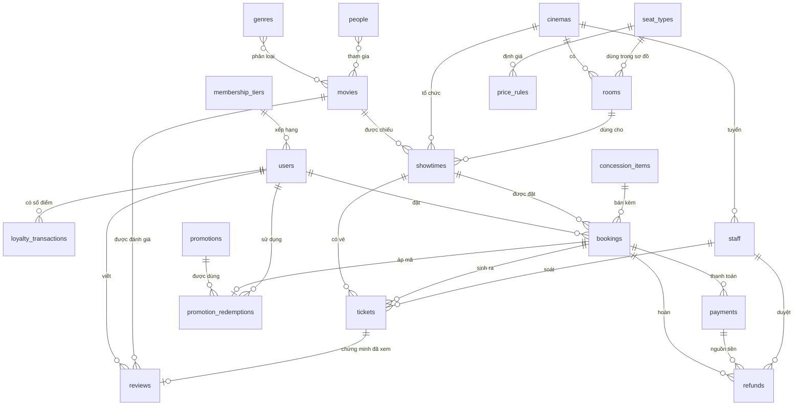

# Thiết kế database

Tên database: `QLDatVeXemPhim`. Gồm 20 collection, chia 6 nhóm.

## Quy tắc thiết kế

**Một thực thể được tách thành collection riêng khi đạt ít nhất một tiêu chí:**

- Có vòng đời và trạng thái riêng.
- Được truy vấn độc lập với document cha.
- Số lượng tăng không giới hạn.
- Là danh mục dùng chung, được tham chiếu từ nhiều nơi.

**Quy tắc áp dụng cho mọi collection:**

1. Có `$jsonSchema` với `validationLevel: strict`, `validationAction: error`, và không nhận trường lạ.
2. Mỗi khóa nghiệp vụ có unique index.
3. Mỗi trường `*Id` trỏ tới document có thật. MongoDB không có khóa ngoại nên `06_verify.js` kiểm tra việc này.
4. Chỉ embed dữ liệu có giới hạn và đi cùng cha. Không có mảng tăng vô hạn.
5. Mỗi trường lặp dữ liệu là **snapshot** (giữ giá trị lúc giao dịch) hoặc **computed** (tính lại được từ dữ liệu gốc).
6. Tiền là số nguyên VND, thời gian là `Date` UTC.
7. Dữ liệu giao dịch không xóa cứng, chỉ đổi `status`. Sổ điểm chỉ ghi thêm.
8. Trường số dùng `bsonType: "number"`, vì `mongosh` có thể lưu số dưới kiểu int hoặc double.

## Sơ đồ quan hệ

## Quyết định embed hay reference

| Dữ liệu | Cách lưu | Lý do |
|---|---|---|
| Ghế theo suất | Embed trong `showtimes` | Giữ nhiều ghế là một thao tác nguyên tử trên một document, khoảng 90 ghế nên xa giới hạn 16MB |
| Sơ đồ ghế | Embed trong `rooms` | Có giới hạn, luôn đọc cùng phòng |
| Dòng bắp nước | Embed trong `bookings` | Thuộc về đơn, là snapshot, không có vòng đời riêng |
| Thành phần combo | Embed trong `concession_items` | Có giới hạn, chỉ tham chiếu trong cùng collection |
| Credits của phim | Embed kèm tên snapshot trong `movies` | Hiển thị phim không cần `$lookup`, vẫn giữ `personId` để tra người |
| Vé | Collection riêng | Mỗi vé có QR và trạng thái riêng, được soát và hoàn độc lập |
| Thanh toán | Collection riêng | Một đơn có thể thử thanh toán nhiều lần |
| Đánh giá, sổ điểm, redemption | Collection riêng | Tăng không giới hạn |

Các thực thể đã cân nhắc và loại vì không phục vụ vấn đề cốt lõi nào: `notifications`, `audit_logs`, `shifts`, tồn kho bắp nước.

## Từ điển dữ liệu

Trường có dấu `*` là bắt buộc. Mọi collection có thêm `_id` kiểu ObjectId. Số lượng là số thực tế sau khi seed.

### Nhóm 1. Khách hàng và thành viên

**`users`** (200): tài khoản khách hàng.

| Trường | Kiểu | Ghi chú |
|---|---|---|
| `fullName`\*, `passwordHash`\* | string | Mật khẩu là giá trị giả |
| `email`\* | string | Unique, đúng định dạng email |
| `phone`\* | string | Unique, 10 chữ số |
| `dateOfBirth` | date | |
| `tierId`\* | ObjectId | → `membership_tiers` |
| `pointsBalance`\* | số nguyên ≥ 0 | Computed từ sổ điểm |
| `lifetimeSpend`\* | số nguyên ≥ 0 | Computed: thanh toán trừ hoàn tiền |
| `status`\* | enum | `active`, `locked` |
| `createdAt`\* | date | |

**`membership_tiers`** (4): `code`\* unique, `name`\*, `rank`\*, `minSpend`\*, `pointMultiplier`\* (≥ 1), `benefits`\* (mảng string).

**`loyalty_transactions`** (3.230): sổ điểm, chỉ ghi thêm.

| Trường | Kiểu | Ghi chú |
|---|---|---|
| `userId`\* | ObjectId | → `users` |
| `type`\* | enum | `earn`, `redeem`, `expire`, `adjust` |
| `points`\* | số nguyên | Âm khi trừ điểm |
| `refType`\*, `refId`\* | enum, ObjectId | `booking`, `refund`, `manual`. Unique cùng `type` |
| `description`, `createdAt`\* | string, date | |

### Nhóm 2. Nội dung phim

**`genres`** (12): `name`\* unique, `slug`\* unique.

**`people`** (80): `fullName`\*, `nationality`\*, `birthYear`, `bio`.

**`movies`** (30):

| Trường | Kiểu | Ghi chú |
|---|---|---|
| `title`\*, `synopsis`\*, `language`\*, `posterUrl` | string | `title` có text index |
| `slug`\* | string | Unique |
| `genreIds`\* | mảng ObjectId | → `genres`, ít nhất 1 |
| `credits`\* | mảng object | `personId`\*, `name`\* (snapshot), `role`\* (`director`, `writer`, `actor`), `character` |
| `durationMin`\* | số nguyên | 30–300 |
| `ageRating`\* | enum | `P`, `K`, `T13`, `T16`, `T18` |
| `formats`\* | mảng enum | `2D`, `3D`, `IMAX` |
| `releaseDate`\* | date | |
| `status`\* | enum | `coming_soon`, `now_showing`, `ended` |
| `ratingSummary`\* | object | `avg`, `count`. Computed từ `reviews` visible |

**`reviews`** (600): `movieId`\*, `userId`\* (unique cặp), `ticketId`\* (unique), `rating`\* (1–10), `comment`, `status`\* (`visible`, `hidden`), `createdAt`\*.

### Nhóm 3. Rạp và nhân sự

**`cinemas`** (5): `code`\* unique, `name`\*, `city`\*, `address`\*, `location`\* (GeoJSON Point, index `2dsphere`), `phone`\*, `openTime`\*, `closeTime`\* (`HH:MM`), `status`\* (`active`, `closed`).

**`rooms`** (15): `cinemaId`\*, `name`\* (unique trong rạp), `format`\*, `seatMap`\* (mảng `row`, `seatCount`, `seatTypeId`), `capacity`\*, `status`\* (`active`, `maintenance`, `closed`).

**`seat_types`** (3): `code`\* unique, `name`\*, `personsPerSeat`\* (1–2).

**`staff`** (30): `cinemaId`\*, `fullName`\*, `email`\* unique, `position`\* (`manager`, `cashier`, `ticket_checker`), `permissions`\* (mảng `ticket_check`, `refund_approve`, `showtime_manage`, `sell_counter`), `status`\*, `hiredAt`\*.

### Nhóm 4. Lịch chiếu và giá

**`showtimes`** (1.140):

| Trường | Kiểu | Ghi chú |
|---|---|---|
| `movieId`\*, `cinemaId`\*, `roomId`\* | ObjectId | Unique `{roomId, startTime}` |
| `startTime`\*, `endTime`\* | date | |
| `format`\* | enum | Lấy từ phòng |
| `language`\* | enum | `subtitle`, `dubbed` |
| `seats`\* | mảng object | `code`\*, `seatTypeId`\*, `price`\*, `status`\* (`available`, `held`, `booked`), `holdUntil`, `holdToken`, `bookingId` |
| `status`\* | enum | `open`, `ended`, `cancelled` |
| `snapshot`\* | object | `movieTitle`, `cinemaName`, `roomName` |

**`price_rules`** (13): `name`\*, `format`\*, `seatTypeId`\*, `dayType`\* (`all`, `weekday`, `weekend`), `timeFrom`\*, `timeTo`\*, `cinemaId` (tùy chọn), `price`\*, `priority`\*, `validFrom`\*, `validTo`, `status`\*.

### Nhóm 5. Bán vé và thanh toán

**`bookings`** (2.859):

| Trường | Kiểu | Ghi chú |
|---|---|---|
| `bookingCode`\* | string | Unique, dạng `BK` + 10 ký tự hex |
| `userId`\*, `showtimeId`\* | ObjectId | |
| `seatCodes`\*, `holdToken`\* | mảng string, string | Ghế đã chọn và khóa giữ ghế |
| `concessions`\* | mảng object | `itemId`, `name`, `unitPrice`, `quantity`, `lineTotal` (snapshot) |
| `ticketAmount`\*, `concessionAmount`\*, `subtotal`\* | số nguyên | `subtotal` = vé + bắp nước |
| `discountAmount`\*, `pointsUsed`\*, `pointsDiscount`\* | số nguyên | |
| `totalAmount`\* | số nguyên | `subtotal` − giảm giá − tiền điểm |
| `promotionId`, `promotionCode` | ObjectId, string | |
| `status`\* | enum | `pending`, `paid`, `cancelled`, `expired`, `partially_refunded`, `refunded` |
| `expiresAt`\*, `paidAt`, `createdAt`\* | date | |
| `snapshot`\* | object | `movieTitle`, `cinemaName`, `roomName`, `startTime` |

**`tickets`** (5.968):

| Trường | Kiểu | Ghi chú |
|---|---|---|
| `bookingId`\*, `showtimeId`\*, `movieId`\*, `userId`\* | ObjectId | |
| `seatCode`\*, `seatTypeId`\*, `price`\* | | Snapshot. Unique partial `{showtimeId, seatCode}` khi vé `active` hoặc `used` |
| `qrCode`\* | string | Unique |
| `status`\* | enum | `active`, `used`, `refunded`, `void` |
| `checkedInAt`, `checkedInBy`, `refundId` | | Có khi đã soát hoặc đã hoàn |
| `createdAt`\* | date | |

**`payments`** (2.943): `bookingId`\*, `userId`\*, `amount`\*, `method`\* (`momo`, `vnpay`, `card`, `bank_transfer`), `status`\* (`success`, `failed`, `requires_refund`), `transactionRef`\* unique, `idempotencyKey`\* unique, `paidAt`, `createdAt`\*.

**`refunds`** (177): `paymentId`\*, `bookingId`\*, `userId`\*, `ticketIds`\* (ít nhất 1), `amount`\*, `reason`\*, `status`\* (`completed`, `rejected`), `approvedBy`\* (→ `staff`), `createdAt`\*.

### Nhóm 6. Bắp nước và khuyến mãi

**`concession_items`** (15): `name`\* unique, `type`\* (`single`, `combo`), `components`\* (mảng `itemId`, `quantity`), `price`\*, `status`\*.

**`promotions`** (6):

| Trường | Kiểu | Ghi chú |
|---|---|---|
| `code`\* | string | Unique, chữ hoa và số |
| `name`\* | string | |
| `discountType`\*, `discountValue`\* | enum, số nguyên | `percent`, `fixed` |
| `maxDiscount`, `minOrder`\* | số nguyên | |
| `maxUses`\*, `perUserLimit`\* | số nguyên | |
| `usedCount`\* | số nguyên | Computed: số redemption `reserved` và `applied` |
| `startAt`\*, `endAt`\*, `status`\* | date, enum | |
| `conditions` | object | `formats`, `daysOfWeek`, `tierCodes` |

**`promotion_redemptions`** (254): `promotionId`\*, `userId`\*, `bookingId`\*, `useNo`\*, `discountAmount`\*, `status`\* (`reserved`, `applied`, `reversed`), `createdAt`\*. Có hai unique partial index, chỉ áp dụng khi `reserved` hoặc `applied`: `{promotionId, userId, useNo}` và `{promotionId, bookingId}`.

## Dữ liệu mẫu

Tên phim, tên người, tên rạp đều hư cấu. Email dùng `example.com`, mật khẩu là chuỗi giả. Tỷ lệ lấp đầy của suất đã chiếu khoảng 5–6%, vì dữ liệu chọn cỡ vừa để dễ đọc, nên không phản ánh rạp thật.
